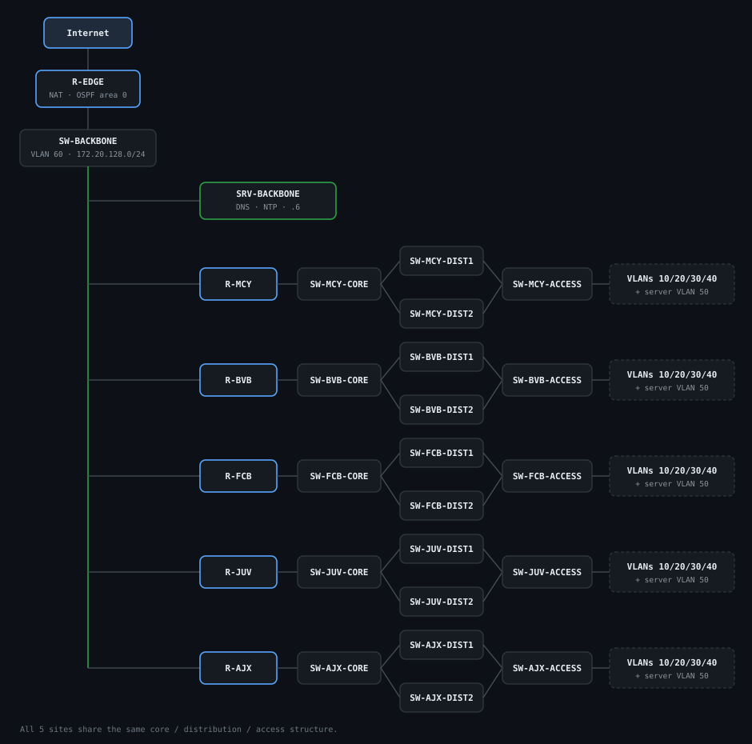

<div>

</div>

# WorldFootballLeague network

A multi-site network for the clubs of the World Football League, with a shared
backbone, one hierarchical LAN per club, and the DNS, DHCP, web and NTP services
that sit behind them.

## Context

The World Football League (WFL) is a fictional club competition in the style of
a club World Cup. Five clubs take part: Manchester City, Borussia Dortmund,
FC Barcelona, Juventus and Ajax Amsterdam. They all connect through a common
backbone, and each club runs its own three-tier LAN built around a core,
a distribution layer and an access layer.

Every club carries one VLAN per group of users (Players, Technical staff, Admin
staff, Network management and Servers), hands out addresses dynamically, resolves
names through a hierarchical DNS, and publishes a small web site with two areas
that need a login: a training area for the players and a tactics area for the
coaching staff. SFTP, device hardening and NTP round out the picture. The whole
design lives inside 172.20.0.0/16, and each club sizing starts from the same
need: up to 30 players, up to 10 technical staff and up to 15 admin staff.

## Lab environment

The border router (R-EDGE), the five club routers (R-CLUB) and the backbone
switch (SW-BACKBONE) are physical Cisco devices with FastEthernet ports. The
club LANs themselves are virtual: they are built in GNS3 with IOU/IOL switches
(interfaces named `Ethernet0/x` and `Ethernet1/x`), and every server is an Ubuntu
Server 22.04 or 24.04 virtual machine (one on the backbone, one per club).

This split between physical and virtual is read from the interface names
(`FastEthernet` on the Cisco hardware, `Ethernet0/0` style on the GNS3 switches),
so treat it as the assumed lab layout rather than a firm requirement.

## Network topology

<p align="center">
  
</p>

Every link between the core and a distribution switch, and between a distribution
switch and the access switch, is a two-port EtherChannel 802.1Q trunk. The full
diagram is in [`docs/topology.md`](docs/topology.md).

## Addressing

The whole design uses 172.20.0.0/16. The backbone sits in 172.20.128.0/24 and
the WAN link in 172.20.255.0/28. Each club owns one 172.20.x.0/24 block, and
every club follows the same internal layout, so you obtain any address by
dropping the club `x` into the tables below.

| Backbone / WAN | Address | Role |
|---|---|---|
| R-EDGE Fa0/0 (WAN) | 172.20.255.3/28 | NAT outside, default route |
| R-EDGE Fa0/1 | 172.20.128.1/24 | OSPF area 0, NAT inside |
| R-MCY/BVB/FCB/JUV/AJX Fa0/0 | 172.20.128.2 to .5 and .7 | club uplinks |
| SRV-BACKBONE | 172.20.128.6/24 | DNS and NTP |
| SW-BACKBONE | 172.20.128.8/24 | management |

| Club | Code | x | Domain | OSPF area | Core router-id |
|---|---|---|---|---|---|
| Manchester City | MCY | 129 | mcy.wfl.lan | 1 | 20.20.20.20 |
| Borussia Dortmund | BVB | 130 | bvb.wfl.lan | 5 | 30.30.30.30 |
| FC Barcelona | FCB | 131 | fcb.wfl.lan | 2 | 40.40.40.40 |
| Juventus | JUV | 132 | juv.wfl.lan | 3 | 50.50.50.50 |
| Ajax Amsterdam | AJX | 133 | ajx.wfl.lan | 4 | 60.60.60.60 |

| VLAN | Name | Subnet | Gateway | DHCP pool |
|---|---|---|---|---|
| 10 | Players | 172.20.x.0/26 | .1 | .2 to .62 |
| 20 | Technical-Staff | 172.20.x.64/28 | .65 | .66 to .78 |
| 30 | Admin-Staff | 172.20.x.96/27 | .97 | .98 to .126 |
| 40 | Network-Mgmt | 172.20.x.128/29 | .129 | static, switches .130 to .132 |
| 50 | Servers | 172.20.x.136/29 | .137 | static, server .138 |

The point-to-point link between a club router and its core uses 172.20.x.144/30
(.145 on the router, .146 on the core). See [`docs/addressing.md`](docs/addressing.md)
for the complete plan.

## Technologies

Everything listed here is actually configured in the files:

- Multi-area OSPF, with area 0 on the backbone and one area per club (1, 5, 2, 3
  and 4). R-EDGE originates the default route.
- Static EtherChannel on every trunk between the core, distribution and access
  switches.
- Rapid-PVST with fixed root priorities and root guard, plus portfast and
  bpduguard on the access ports.
- A black-hole VLAN (666) for unused ports.
- SSH version 2 with a management ACL on the vty lines, port-security on access
  ports, CDP turned off and the HTTP server disabled.
- Outbound NAT overload on R-EDGE.
- Hierarchical DNS on BIND9. The backbone is authoritative for `wfl.lan` and
  forwards each club zone to its club server, which in turn is authoritative for
  its own zone.
- Kea DHCP4 with dynamic DNS and a relay (`ip helper-address`) for VLANs 10, 20
  and 30.
- Apache2 with HTTP basic authentication and a hardening configuration.
- SFTP through the OpenSSH `internal-sftp` subsystem, chrooted per role account.
- A Chrony NTP server on the backbone, with every device syncing to 172.20.128.6.
- DHCP snooping on the access switches for VLANs 10, 20 and 30.

## Repository structure

```
WorldFootballLeague_network/
├── README.md
├── .env.example               secrets for the install scripts (empty template)
├── docs/
│   ├── addressing.md           complete addressing plan
│   └── topology.md             Mermaid diagrams plus link and port details
├── network/                    Cisco IOS configs, one folder per site
│   ├── backbone/               R-EDGE and SW-BACKBONE
│   └── bvb|fcb|juv|mcy|ajx/    R-CLUB and SW-CLUB-CORE/DIST1/DIST2/ACCESS
├── services/
│   ├── backbone/               BIND9, Chrony and install.sh
│   └── bvb|fcb|juv|mcy|ajx/    bind, kea, apache, www, ssh and install.sh
└── clients/
    └── ntp.md                  how to point a client at the NTP server
```

## Deployment

To bring up a network device, paste the matching
`network/<site>/<DEVICE>.conf` into it. Replace `<ENABLE_SECRET>` and
`<ADMIN_SECRET>` with real values first, and generate an RSA key for SSH with
`crypto key generate rsa modulus 2048`.

To bring up a server, run its install script on the target Ubuntu host:

```bash
cd services/bvb           # or backbone, fcb, juv, mcy, ajx
cp ../../.env.example .env # club servers only, then fill in the secrets
sudo ./install.sh
```

The script installs the packages, copies every configuration file into place,
creates the accounts from the environment variables, checks each service with
its own validator (`named-checkconf` and `named-checkzone`, `kea-dhcp4 -t`,
`apache2ctl configtest`, `sshd -t`) and then restarts them. The backbone server
needs no `.env`.

## Possible improvements

- Central logging with syslog or Graylog. Right now each device only keeps local
  timestamps.
- ACLs between VLANs so the user groups cannot reach each other freely.
- A first-hop redundancy protocol such as HSRP or VRRP for the club gateways.
- LACP in place of the static EtherChannel.
- A proper secrets manager instead of a per-host `.env` file.
- IPv6 alongside the current IPv4 plan.
