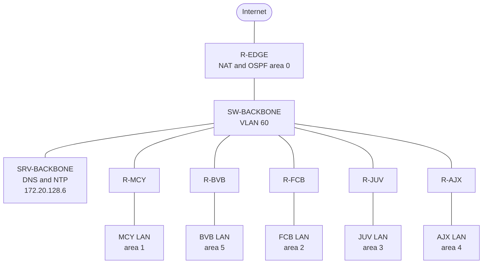
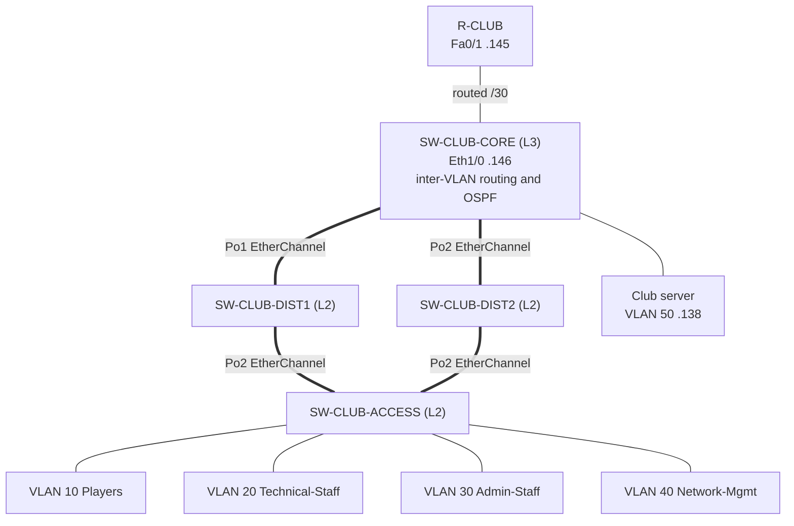

# Topology

## Backbone and clubs

## Club LAN (the same three-tier design in every club)

## Links, EtherChannel and ports

On the backbone:

- R-EDGE uses Fa0/0 as the WAN uplink, where it does NAT outside and holds the
  default route. Fa0/1 faces the backbone switch and runs OSPF in area 0 with a
  priority of 100 and NAT inside.
- SW-BACKBONE is a pure layer 2 switch, so IP routing is turned off. Ports Fa0/1
  through Fa0/6 are access ports in VLAN 60 with port-security, while Fa0/7
  through Fa0/24 are parked in VLAN 666 and shut down.

Inside each club, which has one physical club router and four GNS3 switches:

- The club router reaches the core switch over a routed /30 point-to-point link
  (172.20.x.144/30), and OSPF runs there between the club area and area 0.
- SW-CLUB-CORE is the only layer 3 switch. It hosts the VLAN SVIs, runs OSPF with
  the SVIs passive, and relays DHCP through `ip helper-address`.
- The core connects to each distribution switch with a two-link EtherChannel:
  Port-channel1 to DIST1 on Eth0/0 and Eth0/1, Port-channel2 to DIST2 on Eth0/2
  and Eth0/3. Both are 802.1Q trunks carrying VLANs 10, 20, 30, 40, 50 and 666.
- Each distribution switch connects to SW-CLUB-ACCESS with another EtherChannel
  trunk.
- End hosts plug into SW-CLUB-ACCESS on VLANs 10, 20, 30 and 40, and the club
  server plugs into the core on Eth1/1 in VLAN 50. Any port that is not in use
  goes into VLAN 666 and stays shut down.

## Spanning tree and hardening

- Rapid-PVST runs on every club switch. The root bridge priorities are 4096 on
  the core, 8192 on DIST1, 12288 on DIST2 and 61440 on the access switch, so the
  core is always the root.
- Root guard protects the trunks that must never lead to a better bridge, and
  access ports use portfast together with bpduguard.
- Access ports carry port-security. CDP is turned off, the HTTP server is
  disabled, and SSH version 2 is the only management access, guarded by the
  `ACL-SSH-MGMT` ACL on the vty lines.
- DHCP snooping runs on the access switch for VLANs 10, 20 and 30, and the uplink
  EtherChannels up to the club server are marked as trusted.
